# Hire Journey

Resume-first user onboarding for Hire Journey. A user signs up, uploads a PDF or
DOCX resume, and an LLM extracts a structured profile. The user reviews and
corrects it, sets job preferences, and lands on the app with a complete profile
that later features (job matching, search, scoring) can build on.

## The problem it solves

Job matching needs trustworthy candidate data, but typing out a full work
history, education, projects and tech stack is slow and repetitive. Hire Journey
removes that first-run friction:

- **Prefill from a resume** instead of a long blank form.
- **Human stays the authority.** LLM output is lenient and normalized, then the
  user corrects it through strictly validated forms.
- **Safe by design.** Nothing is half-saved, errors point at the exact field,
  and retries never create duplicate data.

## Quick start

Prerequisites: **Docker**, **Node.js 20+**, and **Python 3.11–3.13** (3.14 is not
supported yet; if you have [`uv`](https://docs.astral.sh/uv/) the script can
provide 3.13 for you).

```bash
git clone https://github.com/careerEnginee/career-engine
cd career-engine
./script.sh
```

That single command:

1. checks prerequisites (and starts Docker Desktop on macOS if needed),
2. creates/starts a PostgreSQL 16 container (`career-engine-db`),
3. creates `backend/.env` and `frontend/.env` and generates a `SECRET_KEY`,
4. creates a Python virtualenv and installs backend dependencies,
5. installs frontend dependencies with `npm ci`,
6. applies Alembic migrations,
7. starts the API and the web app and waits until both are healthy.

Then open **http://localhost:3000**. API docs are at
**http://localhost:8000/docs**. Press `Ctrl+C` to stop everything.

> **Resume extraction needs an LLM key.** Without one the app runs, but uploading
> a resume returns `503`. Get a free key at
> [console.groq.com/keys](https://console.groq.com/keys) and either put
> `GROQ_API_KEY=...` in `backend/.env`, or export it before running:
> `GROQ_API_KEY=... ./script.sh`.

Re-running `./script.sh` is cheap: dependency installs are skipped unless
`requirements*.txt` or `package-lock.json` changed, and existing `.env` files are
never overwritten.

### `script.sh` commands

| Command | What it does |
| --- | --- |
| `./script.sh` / `start` | Full setup if needed, then start everything |
| `./script.sh stop` | Stop backend and frontend (database keeps running) |
| `./script.sh stop --db` | Also stop the Postgres container |
| `./script.sh status` | Show what is running |
| `./script.sh logs` | Follow backend and frontend logs (`.run/*.log`) |
| `./script.sh test` | Run backend (`pytest`) and frontend (`vitest`) tests |
| `./script.sh reset-db` | Delete the database container and **all its data** |

Ports and database settings can be overridden with environment variables:
`BACKEND_PORT`, `FRONTEND_PORT`, `DB_PORT`, `DB_NAME`, `DB_USER`,
`DB_PASSWORD`, `DB_CONTAINER`. If port 5432 is already used (for example by a
local Postgres), the script picks the next free port for its container and
updates `DATABASE_URL` in `backend/.env` automatically. If you change the
database values yourself, make
`DATABASE_URL` in `backend/.env` match. If you change `BACKEND_PORT`, update
`NEXT_PUBLIC_API_URL` in `frontend/.env`, and if you change `FRONTEND_PORT`,
update `CORS_ORIGINS` in `backend/.env`.

## What it does

```mermaid
flowchart LR
  A[Register / Login / Google] --> B[GET /profile snapshot]
  B -->|no resume| C[Upload PDF or DOCX]
  C --> D[Extract text]
  D --> E[LLM extraction<br/>Groq → Gemini → OpenAI]
  E --> F[Normalize + dedupe]
  F --> G[(One DB transaction)]
  G --> H[Review and edit profile]
  H --> I[Set preferences]
  I -->|onboarding_complete| J[Dashboard]
  J --> K[Profile editor]
```



1. **Authenticate** with a local account or Google. The session is an
   `HttpOnly` cookie. The Next.js proxy redirects signed-out visitors to
   `/login`, and every protected API route validates the token itself.
2. **Route by state.** `GET /profile` returns an `OnboardingSnapshot` the
   frontend uses to pick the right step: resume, preferences or dashboard.
3. **Upload a resume** (`POST /profile/cv`, PDF/DOCX, up to 5 MB). Text is
   extracted with PyMuPDF / `python-docx`; corrupt, empty, password-protected
   and image-only files are rejected. The text goes to the first configured LLM
   provider (Groq → Gemini → OpenAI) with schema-constrained output and retries.
   Results are normalized (URLs, dates, lowercase deduplicated technologies) and
   saved **in a single transaction**.
4. **Review details** (`PUT /profile/details`): identity, links, education,
   certifications, employment, projects and technologies.
5. **Choose preferences** (`PUT /profile/preferences`): roles, locations, work
   modes (remote / hybrid / onsite), seniority, optional minimum salary.
6. **Continue** to `/dashboard`. Completion is **computed** from the data on
   every response, never stored, so it can't go stale.
7. **Edit later** at `/profile`, which reuses the same forms. Re-uploading a
   resume replaces the source resume and refreshes resume-derived fields while
   keeping your preferences.

### Reliability features

- One error envelope for every failure: stable `code`, safe `message`, exact
  field `path`s, and a `request_id` on unexpected `500`s. Submitted values are
  never echoed back.
- Content-idempotent uploads: re-sending the same resume reuses the existing row
  (safe retries after timeouts, even at the resume limit).
- Deadlines: 30 s for normal requests, 120 s for resume extraction.
- A failed initial load shows a Retry screen instead of an empty form that could
  overwrite saved data.
- `409 projects_stale` recovery reloads only the projects and keeps all other
  unsaved edits.
- Copy-on-write when renaming a project shared with another profile.
- Year-only education/certification dates are preserved, not coerced to January.
- Accessible inline errors (`aria-invalid`, focus on the first invalid field).

## API overview

All routes are under `/api/v1`. Everything except registration, login, Google
auth and public auth config requires a session.

| Method and path | Purpose |
| --- | --- |
| `POST /auth/register` | Create a local account |
| `POST /auth/login` | Password login (username or email), sets cookie |
| `POST /auth/google` | Google sign-up / sign-in |
| `GET /auth/me` | Current user |
| `POST /auth/logout` | Clear the session cookie |
| `GET /profile` | Onboarding snapshot (`404` until a profile exists) |
| `POST /profile/cv` | Parse and persist a resume |
| `PUT /profile/details` | Save corrected profile details (full replacement) |
| `PUT /profile/preferences` | Save job preferences; returns computed completion |
| `PATCH /profile` | Partial profile update |
| `GET /health` | Liveness check (no prefix) |

Common statuses: `401` sign in again, `409` resume limit or stale project, `413`
file too large, `415` not PDF/DOCX, `422` unreadable file or invalid data, `502`
all LLM attempts failed, `503` no LLM key configured. Details are in the
[onboarding flow doc](docs/architecture/user-onboarding-flow.md).

## Stack

- **Backend:** FastAPI, async SQLAlchemy 2.0, Alembic, PostgreSQL 16
- **Extraction:** Groq, Gemini or OpenAI via LangChain provider packages
- **Resume parsing:** PyMuPDF (PDF), `python-docx` (DOCX)
- **Frontend:** Next.js 16, React 19, TypeScript, Tailwind CSS 4, react-hook-form, zod
- **Tests:** pytest + pytest-asyncio (backend), Vitest + Testing Library (frontend)

## Data model

`users` → one `profiles` row (job preferences live on the profile) → many
`employment_history` rows (linked to shared `companies`), `profile_projects`
(linked to shared `projects`) and technology links. `resumes` belong to a user
(max 2); the profile points to its `source_resume_id`. Technology names are
unique and lowercase, enforced by a database check. See the full ERD in
[database-schema.md](docs/architecture/database-schema.md).

## Project structure

```
career-engine/
├── script.sh              # one-command setup and runner
├── docs/                  # architecture docs and ADRs
├── backend/
│   ├── app/
│   │   ├── api/v1/        # route handlers (auth, profile, resumes)
│   │   ├── models/        # SQLAlchemy ORM models
│   │   ├── schemas/       # Pydantic request/response schemas
│   │   ├── services/      # business logic (services/profile/*)
│   │   ├── utils/         # document parsing, normalization, LLM extraction
│   │   ├── config.py      # settings from env
│   │   ├── database.py    # engine and session
│   │   └── main.py        # FastAPI entry point
│   ├── alembic/           # migrations
│   └── tests/
└── frontend/
    └── src/
        ├── app/           # routes: login, register, onboarding, dashboard, profile
        ├── components/    # onboarding wizard, profile, layout, ui
        ├── hooks/         # profile/preferences state
        └── lib/           # API client, auth context, onboarding routing
```

## Current scope and known limitations

The dashboard is currently a welcome page. Job ingestion, search, scoring,
applications and tailored resumes are not part of this branch (their old
migrations remain in history because they were already shared).

- Extraction is synchronous: the upload request stays open during the LLM call.
- No OCR, so scanned/image-only PDFs are unsupported.
- Detail saves replace everything, so concurrent edits from two tabs can overwrite each other.
- Resume text is stored and sent to a third-party LLM provider; a retention and
  disclosure policy is needed before production use.
- Password login routes straight to `/dashboard` without checking onboarding
  state (registration and Google sign-in do check it).
- The 5 MB upload limit is duplicated in the frontend and backend; change both.

## Manual setup (without `script.sh`)

<details>
<summary>Step-by-step</summary>

```bash
# 1. Database
docker run -d --name career-engine-db \
  -e POSTGRES_USER=postgres -e POSTGRES_PASSWORD=postgres -e POSTGRES_DB=career_engine \
  -p 5432:5432 postgres:16

# 2. Environment
cp backend/.env.example backend/.env
cp frontend/.env.example frontend/.env
python3 -c "import secrets; print(secrets.token_hex(32))"   # paste into SECRET_KEY
# set at least one of GROQ_API_KEY / GEMINI_API_KEY / OPENAI_API_KEY in backend/.env

# 3. Backend
cd backend
python3.13 -m venv .venv && source .venv/bin/activate
pip install -r requirements-dev.txt
alembic upgrade head
uvicorn app.main:app --reload            # http://localhost:8000

# 4. Frontend (second terminal)
cd frontend
npm ci
npm run dev                              # http://localhost:3000
```

</details>

## Day-to-day

```bash
./script.sh test                                   # all tests
cd backend && pytest                               # backend only
cd frontend && npm test                            # frontend only

# after changing a model
cd backend
alembic revision --autogenerate -m "describe the change"
alembic upgrade head
```

Browse the database with DBeaver (host `localhost`, port `5432`, database
`career_engine`, user/password `postgres`) or:

```bash
docker exec -it career-engine-db psql -U postgres -d career_engine
```

## Environment variables

Backend (`backend/.env`):

| Variable | Required | Description |
| --- | --- | --- |
| `DATABASE_URL` | Yes | PostgreSQL connection string (`postgresql+asyncpg://...`) |
| `SECRET_KEY` | Yes | JWT signing secret; `script.sh` generates one |
| `ACCESS_TOKEN_EXPIRE_MINUTES` | No | Token expiry, default 60 |
| `CORS_ORIGINS` | No | Comma-separated allowed frontend origins, default `http://localhost:3000` |
| `GOOGLE_CLIENT_ID` | No | OAuth Web client id for "Continue with Google"; blank disables it |
| `MAX_UPLOAD_MB` | No | Max resume size in MB, default 5 |
| `MAX_RESUMES_PER_USER` | No | Per-user resume limit, default 2 |
| `GROQ_API_KEY` / `GROQ_MODEL` | One key required | Preferred provider (default `llama-3.3-70b-versatile`) |
| `GEMINI_API_KEY` / `GEMINI_MODEL` | One key required | Second choice (default `gemini-2.0-flash`) |
| `OPENAI_API_KEY` / `OPENAI_MODEL` | One key required | Fallback (default `gpt-4o-mini`) |

At least one LLM key is required for resume extraction.

Frontend (`frontend/.env`): `NEXT_PUBLIC_API_URL` (backend origin, default
`http://localhost:8000`) and `NEXT_PUBLIC_GOOGLE_CLIENT_ID` (must match the
backend's Google client id).

> **Google sign-in (optional):** set both client ids and add
> `http://localhost:3000` to the OAuth client's authorized JavaScript origins.

> **Never commit `.env` files.** Each developer keeps their own local copy.

## Troubleshooting

| Symptom | Fix |
| --- | --- |
| "Python 3.11-3.13 is required" | `brew install python@3.13` or install `uv`, then re-run |
| "Port ... is already in use" | Stop the other process or set `BACKEND_PORT` / `FRONTEND_PORT` / `DB_PORT` |
| Resume upload returns `503` | Add an LLM API key to `backend/.env` and re-run `./script.sh` |
| Resume upload returns `502` | All providers failed; check key validity and provider status |
| Browser shows CORS errors | Make `CORS_ORIGINS` include the exact frontend origin |
| Something is stuck | `./script.sh logs`, or `./script.sh stop` then `./script.sh` |
| Want a clean database | `./script.sh reset-db` then `./script.sh` |

## Documentation

- [Documentation index](docs/README.md)
- [End-to-end user onboarding flow](docs/architecture/user-onboarding-flow.md)
- [Current database schema and ERD](docs/architecture/database-schema.md)
- [Architecture decisions](docs/adr/)

Update the relevant documentation in the same pull request as schema or
business-rule changes.
