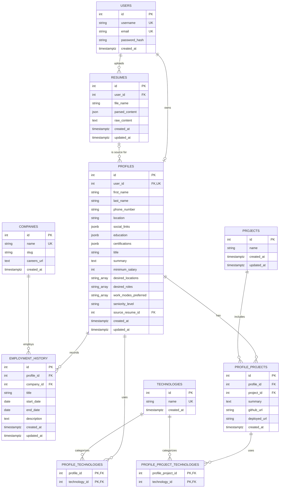

# Current database schema

- Status: current as of 2026-08-04
- Alembic head: `f82d1c6a4e39`
- Implementation: `backend/app/models/`

This document describes the ORM schema used by the user-onboarding branch. The
SQLAlchemy models are the executable source of truth for this branch. Historical
Alembic revisions remain immutable so existing databases and downstream
branches retain a reproducible migration chain.

## Entity relationship diagram

## Ownership and modelling rules

### Users and profiles

- A user has at most one profile. `profiles.user_id` is both a foreign key and
unique.
- Local credentials store `password_hash`, never a plaintext password.
- `google_id` is not stored. Google authentication does not have a dedicated
database table in the current design.
- Job preferences are part of `profiles`; there is no separate preferences
table.
- `social_links` is a JSONB object intended for keys such as `linkedin_url`,
`github_url`, and `portfolio_url`.
- Education and certifications are JSONB arrays because they are currently
profile-owned display data and are not queried or shared independently.

### Projects and employment

- `projects` stores project identity only.
- `profile_projects` is the project membership bridge. It owns the summary and
URLs supplied by that profile. A unique constraint prevents the same
profile/project pair from being inserted twice.
- Project dates, role, contribution summary, and project-level technology
arrays were removed. Technologies are connected through
`profile_project_technologies`.
- An employment-history row represents one profile's employment stint; it is
not a globally shared employment record. Companies are normalized and shared.
- A null employment `end_date` means the position is current. The database
rejects an end date earlier than the start date.

### Technologies

- `technologies.name` is the normalized identity and is unique.
- Names are trimmed, whitespace-collapsed, and lowercased by the application.
- A database check constraint rejects non-lowercase direct inserts.
- `profile_technologies` and `profile_project_technologies` use composite
primary keys, which prevent duplicate associations.

### Resumes

- A user may hold at most two resumes. The service locks the user row and counts
existing resumes before insertion, making concurrent uploads safe.
- The limit is currently an application-service rule, not a database check
constraint; SQL cannot express a cross-row count with a normal check.
- There is no `slot_number` or `is_active` column. The newest resume by
`created_at` is treated as the current resume.
- Replacing a resume updates the existing row without consuming another slot.

### Branch scope and migration history

- Job ingestion, search, evaluation, and tailored-resume ORM modules are not
  registered on this onboarding branch.
- Historical migrations that mention those domains are retained because they
  have already been shared and are ancestors of the onboarding migration head.
- Downstream job branches retain their own models and implementation. Removing
  them from this branch does not remove their Git history or branch contents.

## Constraint and validation matrix

| Rule                                | Database                  | Model/schema       | Service                 | Frontend              |
| ----------------------------------- | ------------------------- | ------------------ | ----------------------- | --------------------- |
| One profile per user                | Unique FK                 | Integer IDs        | Upsert by user          | Pending onboarding UI |
| Nonnegative minimum salary          | Check constraint          | Pydantic `ge=0`    | —                       | Pending               |
| Social links is an object           | JSONB type check          | Dictionary shape   | Merge nonempty links    | Pending URL/key rules |
| Education/certifications are arrays | JSONB type checks         | List shape         | —                       | Pending item rules    |
| Employment end is not before start  | Check constraint          | Not yet mirrored   | —                       | Pending               |
| Technology names are lowercase      | Check constraint + unique | ORM validator      | Normalized upsert       | Pending               |
| No duplicate profile/project pair   | Unique constraint         | —                  | —                       | —                     |
| No duplicate technology bridge rows | Composite PK              | —                  | Conflict-safe insert    | —                     |
| Maximum two resumes                 | —                         | Constant is tested | Row lock + count        | Pending               |
| Current resume is newest upload     | —                         | No active field    | Ordered by `created_at` | Display pending       |

## Referential actions

- Deleting a user cascades to their profile and uploaded resumes.
- Deleting a profile cascades to its employment rows, project memberships, and
technology memberships.
- Deleting a project cascades to its profile memberships.
- Referenced companies and technologies use restrictive deletion semantics to
avoid silently losing employment or technology meaning.
- Deleting the resume referenced by `profiles.source_resume_id` sets that field
to null.

## Removed legacy schema

The refactor removed the following entities from the current ORM metadata and
database schema:

- `applications` and the `applicationstatus` PostgreSQL enum;
- `job_notes`;
- `job_scores`;
- `search_sessions`; and
- the legacy `sources` entity.

Historical migrations still mention these objects. That is intentional:
migration history must remain reproducible and should not be rewritten after it
has been shared.

## Known limitations and deferred decisions

- The UUID-to-integer migration is a destructive development reset; it does not preserve existing rows.
- Profile JSONB fields validate their top-level type, but their inner object
schemas are intentionally flexible for now.
- The resume limit is not protected from direct SQL writes that bypass the
service.
