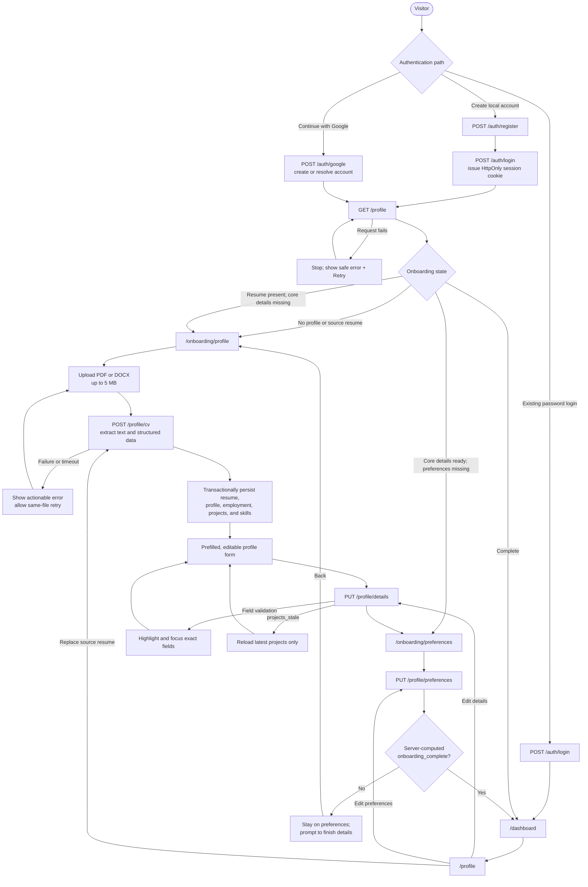

# User onboarding flow

- Status: current as of 2026-07-24
- Implementation branch: `feat/user-onboarding`
- Comparison base: `development` at `0325655`
- Error-hardening implementation: `d8d626a`
- Related decision: [ADR-0002](../adr/0002-resume-first-snapshot-onboarding.md)

This document describes the user journey from account creation through a
completed Hire Journey profile. It also records the frontend routing rules,
backend API contract, resume-extraction pipeline, persistence semantics, and
recovery paths that support that journey.

## Flow at a glance



The local password sign-in screen currently sends existing users directly to
`/dashboard`. Local registration and Google authentication inspect the
onboarding snapshot before routing. A user without a source resume who opens
`/profile` is sent back to the resume step; a partially completed user with a
source resume can finish through the reused editor forms.

## Onboarding state model

The backend does not store a completion flag. Every onboarding response
computes `onboarding_complete` from the current profile, which prevents a stale
flag from disagreeing with the underlying data.

| State | Server-side evidence | Destination |
| --- | --- | --- |
| Not started | `GET /profile` returns `404`, or no source resume exists | `/onboarding/profile` |
| Resume uploaded, details incomplete | A source resume exists, but first name, last name, or title is blank | `/onboarding/profile` |
| Details ready, preferences incomplete | Source resume, first name, last name, and title exist; at least one preference requirement is missing | `/onboarding/preferences` |
| Complete | Source resume, first name, last name, title, at least one desired role, at least one desired location, at least one work mode, and seniority all exist | `/dashboard` |

Minimum salary is optional and does not affect completion. Desired location is
required.

## End-to-end user journey

### 1. Authenticate

- Local registration creates the user, immediately signs them in, hydrates the
  client session through `GET /auth/me`, and checks their onboarding snapshot.
- Google authentication verifies the Google credential in the backend, resolves
  an account by verified email or creates one, issues the same application
  session, and checks the snapshot.
- Authentication uses an `access_token` cookie with `HttpOnly`, `SameSite=Lax`,
  and the configured expiry. The frontend includes credentials on every API
  request.
- The Next.js proxy redirects unauthenticated visitors to `/login`. Protected
  API endpoints independently validate the token and resolve the current user.

`postAuthDestination()` treats a profile lookup failure as non-blocking and
falls back to `/dashboard`; a temporary profile API failure therefore does not
turn a successful login into a failed login. Once an onboarding or profile
editor is open, an initial snapshot failure does not render a blank editable
form. The page shows a load-error state with Retry so a save cannot overwrite
stored values with empty client state.

### 2. Upload and parse a resume

The profile step initially shows a drag-and-drop uploader. The browser accepts
one `.pdf` or `.docx` file and rejects files over 5 MB before sending them. The
backend repeats both checks and does not trust the client-provided size.

`POST /api/v1/profile/cv` performs the following work:

1. Extract plain text with PyMuPDF for PDF or `python-docx` for DOCX, including
   text in DOCX tables.
2. Reject corrupt, password-protected, empty, or image-only documents.
3. Send the extracted text to configured LLM providers in the order Groq,
   Gemini, then OpenAI. Each provider is asked for schema-constrained output;
   invalid results are retried.
4. Accept lenient extraction fields so a partially understood resume can still
   reach the correction screen. Missing values remain empty rather than being
   invented.
5. Normalize values for persistence: trim and bound strings, normalize URLs and
   dates, lowercase and deduplicate technologies, discard unusable relationship
   rows, and collapse duplicate employment or project entries.
6. In one database transaction, create or replace the resume, upsert the
   profile, replace resume-derived technologies, employment, and projects, and
   set the profile's `source_resume_id`.
7. Return a fresh onboarding snapshot to prefill the UI.

The LLM call happens before database locks or writes. If parsing, extraction, or
persistence fails, no partial onboarding state is committed.

Resume creation is content-idempotent after text extraction. While holding the
existing per-user database lock, the service looks for a resume with identical,
non-empty extracted text before enforcing the two-resume limit. A match is
updated and reused, including when the account is already at the limit.
Concurrent identical uploads serialize on the same lock and therefore produce
one resume row. Logs record only the user and reused resume IDs, never resume
content.

The browser gives CV extraction 120 seconds; other API requests use a 30-second
deadline. The deadline remains active until a success or error response body is
fully parsed, not merely until response headers arrive. A timed-out request may
still finish on the server, so content idempotency makes a same-file retry safe.
The hidden file input is reset after each selection so selecting the identical
file emits another change event. The dropzone supports click, drag-and-drop,
Enter, and Space.

The resume row stores extracted text in `raw_content` and the original
structured extraction in `parsed_content`. The onboarding snapshot exposes only
resume metadata and its summary; it never returns the raw resume text.

### 3. Review and correct profile details

After extraction, the user can edit:

- name, phone number, location, professional title, and summary;
- GitHub, LinkedIn, and portfolio links;
- education and certifications;
- employment history;
- projects and each project's technologies; and
- the profile-level technology list.

`PUT /api/v1/profile/details` is a full replacement of the details step. Empty
UI rows are omitted, omitted collection entries are removed, and the entire save
is atomic. User-edited payloads are validated strictly: required row fields,
date formats and ordering, URLs, collection limits, and string lengths must all
be valid.

Employment dates require `YYYY-MM`. Education and certification dates accept
either `YYYY` or `YYYY-MM`, preserving the precision present in a resume instead
of inventing January for a year-only value. Those fields default to a native
month picker and offer an explicit year-only mode. Both client and server reject
an end year/month that unambiguously precedes its start; when one value has only
year precision, two values in the same year are not treated as ordered.

Project IDs are ownership-checked. Renaming a project that another profile also
references uses copy-on-write, so another user's project identity is not
modified. Shared company rows are reused case-insensitively and are never
deleted when a profile changes its employment history.

A submitted project ID that no longer belongs to the profile returns
`409 projects_stale` with the submitted project-row index. The client preserves
a payload-index-to-visible-row map when it filters blank rows, highlights the
correct editor row, and offers **Reload latest projects**. Recovery fetches a
fresh snapshot and replaces only the projects collection: unsaved identity,
links, education, employment, technologies, and preferences remain untouched.
The project editor alone is disabled while reloading. If reload fails, the
existing project edits and recovery action remain available.

### 4. Choose job preferences

The preferences step collects:

- one or more desired roles;
- one or more desired locations;
- one or more work modes: remote, hybrid, or onsite;
- one seniority level; and
- an optional non-negative minimum salary.

`PUT /api/v1/profile/preferences` trims and deduplicates list values, validates
the allowed work modes and seniority values, saves the preferences, and returns
a fresh snapshot. The frontend moves to `/dashboard` only when that response
reports `onboarding_complete: true`; otherwise it asks the user to finish the
specific requirements listed in `completion_issues`.

### 5. Continue into the application

The dashboard is the completed destination and uses the shared application
shell. The shell exposes Dashboard and Profile navigation, shows the signed-in
account, and logs out through `POST /auth/logout` before returning to `/login`.

### 6. Edit or replace data later

`/profile` reuses the onboarding detail and preference forms with completion
redirects disabled. Saves stay on the page and show success or error feedback.

Selecting a new resume from the existing profile replaces the current source
resume in place by passing `replace_resume_id`. Resume-derived detail fields and
collections are replaced, including clearing values absent from the new resume;
job preferences are deliberately preserved. The service supports at most two
resume records per account, although the current onboarding UI replaces its
source record instead of consuming another slot.

## API contract

All routes below are under `/api/v1` and require an authenticated user except
registration, login, Google authentication, and public auth configuration.

| Method and path | Purpose | Success response | Important semantics |
| --- | --- | --- | --- |
| `POST /auth/register` | Create a local account | `UserRead` (`201`) | Does not issue a session by itself |
| `POST /auth/login` | Password login | Token plus session cookie | Accepts username or email in form field `username` |
| `POST /auth/google` | Google sign-up/sign-in | Token plus session cookie | Requires a verified Google email |
| `GET /auth/me` | Hydrate the client session | `UserRead` | Resolves the cookie to the current user |
| `POST /auth/logout` | End the session | Confirmation object | Clears the session cookie |
| `GET /profile` | Load all onboarding state | `OnboardingSnapshot` | Returns `404` until a profile exists |
| `POST /profile/cv` | Parse and persist a resume | `OnboardingSnapshot` (`201`) | Optional `replace_resume_id` must belong to the user |
| `PUT /profile/details` | Save corrected profile data | `OnboardingSnapshot` | Full replacement of profile-owned collections |
| `PUT /profile/preferences` | Save matching preferences | `OnboardingSnapshot` | Response contains freshly computed completion |
| `PATCH /profile` | Partial profile update | `ProfileRead` | Available to other clients; the current web editor uses the two `PUT` routes |

`OnboardingSnapshot` is the shared response shape for the read, upload, detail,
and preference steps. It contains the profile, source-resume metadata,
employment history, projects, computed completion state, and
`completion_issues`. Each completion issue names its owning step, field path,
and user-facing message. Returning the same shape after every mutation lets the
browser replace local state with the server's normalized source of truth and
explain every remaining requirement.

## Error contract and client behavior

Every backend non-2xx response uses one safe envelope:

```json
{
  "error": {
    "code": "validation_error",
    "message": "Some details need fixing.",
    "fields": [
      {
        "path": ["education", 0, "start_date"],
        "message": "must be in YYYY or YYYY-MM format"
      }
    ]
  }
}
```

FastAPI request-validation errors, raised HTTP exceptions, onboarding domain
errors, and uncaught exceptions all pass through this contract. Validation
responses expose only paths and safe messages; they do not echo submitted
values or Pydantic context. Unexpected `500` responses hide exception details,
add a support `request_id` to the envelope, and retain CORS headers so the
browser can actually display the response. Provider exception text is logged
server-side but is not exposed as the extraction message.

The frontend converts the envelope into `ApiError`, while retaining support for
legacy FastAPI string and validation-array `detail` bodies. It never assigns an
object to `Error.message`, eliminating `[object Object]` messages. Structured
field paths become inline errors with `aria-invalid` and accessible
descriptions; the details form focuses the first invalid field. Group controls
map descendant paths such as `work_modes_preferred.0` to their section, and any
unmappable preference error remains visible in a persistent summary. Malformed
successful JSON becomes `invalid_response`; deadlines and network failures have
separate safe messages. Error toasts show the request reference when present.

## Failure and recovery behavior

| Status | Typical cause | User recovery |
| --- | --- | --- |
| `401` | Missing, expired, or invalid session | Sign in again |
| `404` | Profile not started, or replacement resume not owned/found | Start with a resume upload; do not reuse foreign IDs |
| `409` | Resume limit, or a submitted project became stale | Replace/remove a different resume; retrying identical content reuses its row. For `projects_stale`, reload the latest projects and review them |
| `413` | Upload exceeds the backend size limit | Upload a smaller document |
| `415` | Filename is not PDF or DOCX | Choose a supported format |
| `422` | Unreadable/no-text document or invalid edited data | Correct the file or highlighted profile data |
| `500` | Unexpected backend failure | Retry and give support the displayed request reference |
| `502` | Every configured LLM attempt failed | Retry; inspect provider health if persistent |
| `503` | No LLM provider key is configured | Configure at least one provider and restart the backend |

The frontend keeps the user on the current step and combines inline field
errors with a safe summary toast. A failed re-upload restores the existing
editable profile rather than discarding it. A failed initial load stops at a
Retry screen instead of exposing an empty form.

## Configuration

Backend onboarding settings:

- `MAX_UPLOAD_MB` defaults to `5`.
- `MAX_RESUMES_PER_USER` defaults to `2`.
- At least one of `GROQ_API_KEY`, `GEMINI_API_KEY`, or `OPENAI_API_KEY` is
  required for resume extraction; their corresponding model variables are
  optional overrides.
- `CORS_ORIGINS` must include the frontend origin.
- `GOOGLE_CLIENT_ID` enables backend verification for Google authentication.

Frontend settings:

- `NEXT_PUBLIC_API_URL` is the backend origin, for example
  `http://localhost:8000`.
- `NEXT_PUBLIC_GOOGLE_CLIENT_ID` must match the backend's Google OAuth web
  client when Google authentication is enabled.

The browser currently enforces a fixed 5 MB upload limit. If the backend limit
changes, update the frontend limit at the same time so the two checks remain
consistent.

## Verification coverage

- Backend tests cover PDF/DOCX text extraction, provider fallback and retries,
  atomic resume persistence, normalization, deduplication, sequential and
  concurrent same-content reuse, resume limits, structured error envelopes,
  exact validation paths, project-stale row paths, and computed completion
  issues.
- Frontend tests cover snapshot routing, load-error recovery, profile hydration
  and payload mapping, request/body-parsing deadlines, legacy and current error
  parsing, accessible same-file upload retries, year/month inputs, inline field
  mapping, filtered project-row mapping and projects-only recovery, preference
  validation, and completion redirects.

Relevant suites live in `backend/tests/test_*onboarding*`,
`backend/tests/test_process_cv.py`, `backend/tests/test_document_parser.py`,
`backend/tests/test_llm_extraction.py`, and `frontend/src/**/*.test.ts(x)`.

## Known limitations and follow-ups

- Extraction is synchronous, so the upload request remains open during the LLM
  call and the UI can show only an indeterminate parsing state. Client timeout
  does not prove the server stopped processing; identical-content reuse makes
  retries safe but does not provide progress.
- Scanned/image-only PDFs are unsupported because there is no OCR stage.
- Full-replacement detail saves are simple and deterministic but can overwrite
  a concurrent edit from another browser tab.
- Resume text and structured extraction contain personal information. A
  retention/deletion policy and explicit user-facing provider disclosure should
  be settled before production use.
- Existing password login currently routes directly to the dashboard instead of
  consulting onboarding state; registration and Google authentication do
  consult it.
